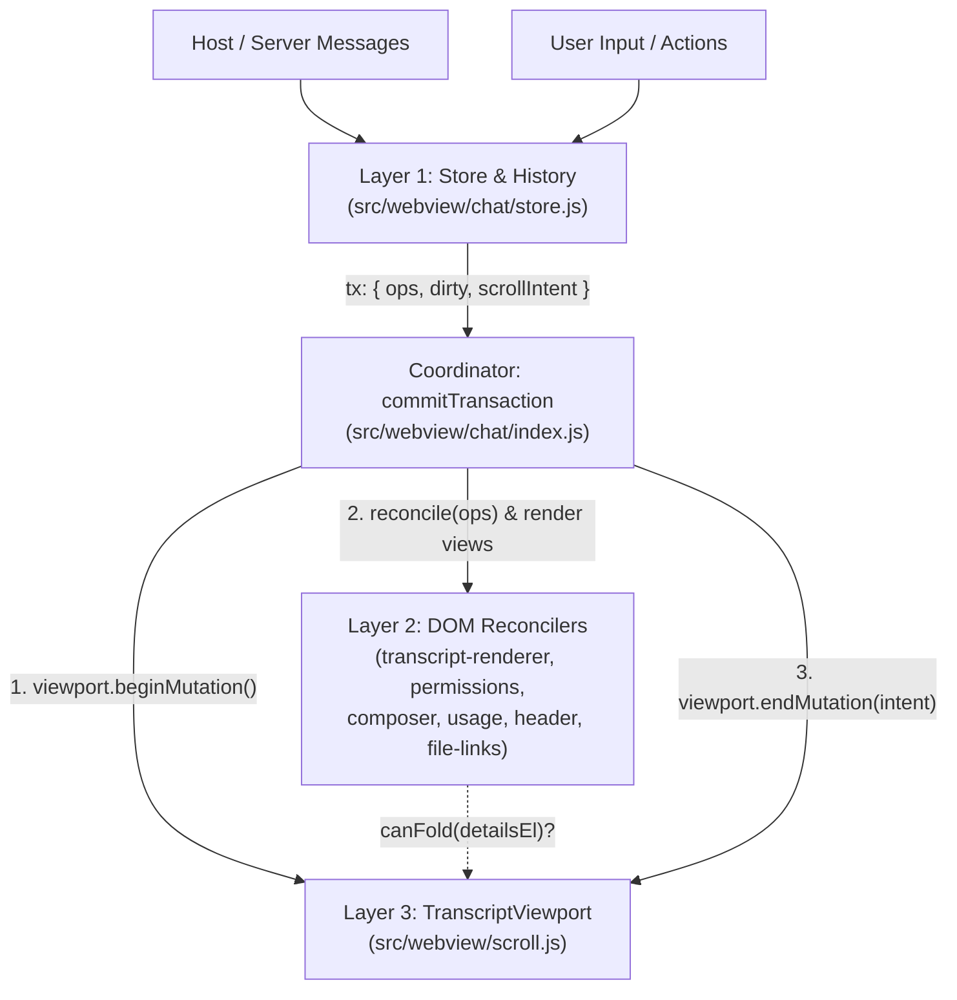

# Архитектура расширения OpenCode VS Code

Этот документ описывает модульную структуру расширения и строгий конвейер работы Webview, чтобы новые визуальные фичи (схлопывание шагов, анимации, карточки инструментов, индикаторы прогресса и артефакты) добавлялись предсказуемо — без скачков скролла, устаревших якорей и разрастания монолитных файлов.

---

## 1. Карта модулей

### Extension Host (`src/`)

| Модуль | Назначение |
| --- | --- |
| `src/extension.js` | Точка входа (`activate`/`deactivate`), инициализация сервисов, реестр открытых вкладок и подписок VS Code. |
| `src/commands.js` | Пользовательские команды VS Code (создание/удаление/переименование сессий и папок, архивация, открытие конфигов). |
| `src/session-panel.js` | Жизненный цикл вкладки чата (`SessionPanel`), иконки состояний таба, маршрутизация сообщений Webview ↔ Host и управление ходом (`turn`). |
| `src/panel/html.js` | Сборка HTML-оболочки Webview, CSP nonce и встроенного SVG-спрайта иконок провайдеров. |
| `src/panel/billing.js` | Лимиты контекста, порог компактификации, баланс провайдера, учёт тарифов по шагам (`costSplit`) и восстановление `turnStats`. |
| `src/panel/permissions.js` | Очередь запросов разрешений (`permission`), сохранение правил проекта, поллинг `Smart`-классификатора и формы вопросов (`elicitation`). |
| `src/panel/subagents.js` | Поллинг дочерних сессий субагентов и слияние с live ACP-обновлениями. |
| `src/panel/workspace-actions.js` | Проверка существования ссылок на файлы, открытие файлов/диффов/внешних URL и загрузка `/`-команд и `@`-скиллов. |
| `src/session-client.js` | Серверный транспорт сессии: подписка на SSE (`ServerEvents`), сверка снапшотов истории/очереди (`inbox`) и идемпотентная отправка промптов. |
| `src/session-protocol.js` | Чистые адаптеры преобразования серверных структур инструментов, вложений и форм в формат Webview. |
| `src/opencode-sync.js` | Координатор двусторонней синхронизации `opencode.json(c)` ↔ настроек VS Code. |
| `src/sync/rules.js` | Чистые правила совместимости схем и 3-way merge (`decideSync`). |
| `src/sync/vs-sides.js` | Адаптеры чтения/записи настроек VS Code (`ApiVsSide` и `FileVsSide` для Remote-окон). |

---

### Webview Чата (`src/webview/` → сборка через `npm run build:ui` в `media/`)

> **Важно:** Файлы `media/chat.js`, `media/chat.css`, `media/rich-text.js` и `media/diagrams.js` являются **артефактами сборки** (`scripts/build-ui.js` на базе `esbuild`). Редактируйте исходники в `src/webview/**`, после чего запускайте `npm run build:ui`.



#### Слои Webview и их строгие границы

1. **Layer 0 — Чистые вычисления и метаданные (`format.js`, `tool-metadata.js`):**
   - Форматирование токенов, сумм, длительностей, расчёт порога компактификации, парсинг патчей и агрегация сводок шагов (`Read 2 files · Edited 1 file`).
   - Не содержат состояния и не обращаются к DOM.

2. **Layer 1 — Store истории и состояния сессии (`src/webview/chat/store.js`):**
   - Единственный владелец данных сессии, нормализованного состояния стриминга/снапшотов, очереди отправленных сообщений (`submissions`), биллинга, автодополнения `/` и `@` и живого статуса.
   - **Запрещено:** обращаться к `document`, `window`, DOM-узлам или скроллу.
   - На каждое событие возвращает декларативную транзакцию `tx = { ops, dirty, scrollIntent }`.

3. **Layer 2 — Рендеринг и сверка DOM (`transcript-renderer.js` и `*-view.js`):**
   - Применяет `tx.ops` и обновляет только помеченные в `tx.dirty` участки интерфейса.
   - Каждому корневому блоку в `#messages` присваивается стабильный `data-anchor-id` (как для серверных снапшотов, так и для ACP-стриминга), а карточкам инструментов — `data-tool-call-id`.
   - **Запрещено:** писать в `element.scrollTop`, вызывать `scrollIntoView()` или заводить локальные хелперы `scrollToBottom()`. Это проверяется автоматически в `test/webview-architecture.js`.

4. **Layer 3 — Контроллер вьюпорта и якорей (`src/webview/scroll.js`):**
   - Единственный владелец `#messages.scrollTop` и трёх состояний чтения:
     - `following` — приклеен к нижнему краю (терминальный режим слежения за выводом).
     - `parked` (`!following && !navigating`) — зафиксирован на конкретном визуальном якоре читателя (`reading`). Никакие обновления выше или ниже не имеют права сдвинуть пиксели читаемого абзаца/шага.
     - `navigating` — выполняется явный переход пользователя (`scrollToElement`).
   - Транзакции `beginMutation()` / `endMutation(intent)` подавляют промежуточные срабатывания `MutationObserver`/`ResizeObserver` внутри пачки обновлений **без сброса флага `following`** (устраняет ложные отложенные схлопывания и двойные пересчёты скролла).
   - Снимок геометрии `lastLayout` защищает якорь даже в случае, когда изменение `scrollTop` и изменение высоты элемента происходят внутри одного 16мс кадра до доставки браузерного события `scroll`.

---

Подробности общего состояния мыслей, прямых подписей и асинхронного провайдера:
[Заголовки мыслей](thought-captions.md).

## 2. Стили Webview (`src/webview/styles/*.css`)

Вместо единого монолитного файла стили разбиты по доменам и собираются в `media/chat.css`:
- `base.css` — CSS-переменные темы VS Code, строгий `overflow: clip` на `html/body/#app`, градиенты `.edge-fade`.
- `header.css` — верхняя панель статуса, пульсация фоновых задач, прогресс плана, полоска субагентов.
- `transcript.css` — скроллпорт `.messages`, пузыри сообщений, закреплённый промпт `.sticky-prompt`, статусы доставки, кнопка `.disclosure-collapse`.
- `steps-and-tools.css` — **единая анатомия раскрывающихся полос** (см. раздел 3), `.turn-steps` (raw live-поток и схлопнутый шеврон), `.thought` (обычные и компактные однострочные), `.tool-group`, `.command-progress`, `.plan`.
- `permissions.css` — карточки разрешений, превью диффов, сохранение правил и формы вопросов `.elicitation`.
- `markdown-and-visuals.css` — типографика `.md`, код, KaTeX, Mermaid-диаграммы, таблицы результатов и панель `#artifacts`.
- `composer.css` — поле ввода, вложения, меню `/` и `@`, селекторы модели/усилия/профиля прав и шкала контекста `.usage-bar`.

### 2.1. Плашка ввода: наложение, а не изменение высоты переписки

При высоте окна больше 420 px `.composer` имеет `position: absolute` внутри `#app`.
`#workspace` оставляет **постоянные 150 px** под компактную плашку; при ширине до
700 px резерв составляет **170 px**, поскольку метаданные занимают две строки.
Это сохраняет около 20 px между нижней границей переписки и строкой `Agent`
стандартного футтера. Рост ввода и
добавление вложений перекрывают больше текста, но **не меняют геометрию скроллпорта**:
`#messages.clientHeight`, `scrollHeight`, границы элемента и `scrollTop` должны
оставаться прежними. Это относится и к `parked`, и к `following`; при вводе текста
нельзя сдвигать переписку даже ради удержания её нижнего края. Новый ответ по-прежнему
обрабатывает существующий контроллер слежения.

Не заменяйте наложение обычным потоком (`relative`/`static` как flex-элемент),
динамическим отступом рабочей области или компенсацией через запись в `scrollTop`.
Сохранение якоря после изменения размера не заменяет этот контракт: размер вообще
не должен изменяться от редактирования черновика. Уменьшение и очистка ввода должны
открывать ранее перекрытый текст на тех же экранных координатах.

Исходный адаптивный предел `min(65%, calc(100% - 150px))` оставляет доступной часть
рабочей области. Он зависит от размера окна, а не от постоянного резерва под
компактную плашку; отдельного фиксированного лимита высоты нет.
Картинка и четыре строки помещаются целиком
в обычном окне; дальнейший текст прокручивается внутри `#input`. Вложения,
метаданные и кнопки находятся вне этого скроллпорта; `#composer-controls` не
прокручивается. Формы вопросов имеют отдельный существующий скроллпорт `#questions`.

Нижний fade рабочей области расположен на фиксированной линии отсечения текста.
Когда плашка поднимается выше неё, эта полоса скрывается под плашкой, а
`.composer::before` продолжает плавное исчезновение у её верхней границы.
Рост меняет **видимую область**, а не размер и диапазон прокрутки переписки.

Существующее исключение: при высоте окна до 420 px плашка переходит в обычный поток,
а резерв рабочей области обнуляется. Для этого режима проверяется доступность
элементов управления; он не является основанием менять режим наложения остальных окон.

Регрессии: `test/ui/composer-overlay.spec.js` проверяет геометрию, положение абзаца
и прокрутку на каждом кадре при росте/уменьшении, в том числе при слежении и чтении
у нижнего края, а также вложение с четырьмя строками, рост в доступном месте и колесо на обоих
краях текстового поля. `plate-fade.spec.js` и `edge-fade.spec.js` проверяют границы fade;
`scroll-architecture.spec.js` — короткие окна и контракт контроллера.

---

## 3. Классификация блоков транскрипта и единая анатомия полосок

Все раскрывающиеся блоки транскрипта (**disclosure strips**) строятся по одному скелету — сводить к нему новые блоки обязательно, изобретать собственную вёрстку полоски запрещено. Геометрия (сетка, высота, шеврон, фокус) — общая; типографика и фишки — ролевые.

### Скелет полоски (общая сетка summary)

```
<details class="<роль>">                     ← свернуто: одна полоска
  <summary>                                  ← grid: шеврон | kind | detail | tokens | status | action
    (::before — общий CSS-шеврон, вращается при [open])
    <span class="kind">…</span>              ← слот 2: метка («7 steps», «Execute», «Thinking…», «PLAN»)
    <span class="name">…</span>              ← слот 3: mono-путь / метрики шагов / .command-progress
    <span class="tokens">…</span>            ← слот 4: оценка токенов (правый край)
    <span class="status">…</span>            ← слот 5: done / failed / in background
    <button class="background-stop">…</button> ← слот 6: действие (Stop у фоновых)
  </summary>
  <div class="body">…</div>                  ← раскрытое содержимое
</details>
```

Токены: `--oc-chev` (ширина клетки шеврона) и `--oc-strip-h` (минимальная высота полоски) — в `base.css`; ширина слота метки — `--oc-kind` на роли (`72px` у `.turn-steps`, `144px` у `.tool-group`, `max-content` у остальных).

### Таксономия блоков

| Класс | Роль | Слоты полоски | Уникальные фишки (сохраняются) |
| --- | --- | --- | --- |
| `.turn-steps` (+ `.live`) | контейнер шагов хода | kind «N steps», name=метрики, tokens | live-режим без шеврона; рейл-линия у раскрытого тела; авто-сворачивание только через `canFold` |
| `.tool-group` (+ `.single`) | вызов инструмента / группа | kind («Execute», «Read 2 files»), name (mono), tokens, status | жирная метка; hover подсветка пути; варианты ниже |
| `.tool-group.progress-task` | команда с прогрессом | + `.command-progress` в слоте detail (name скрыт) | inline прогресс-бар и счётчик `847 / 1,203` |
| `.tool-group.background-task` (+ `.standalone-task`) | фоновая команда | + `.background-stop` в слоте action | кнопка Stop, статус `in background` с общей пульсацией, живёт вне `.turn-steps` |
| `.thought` (+ `.streaming`, `.compact`) | рассуждение модели | kind («Thinking…»/«Thoughts»), tokens | тихий курсив, «чистый текст»; `.compact` — однострочность без полоски вовсе; многоточие стрима |
| `.plan` | план хода | kind «PLAN», tokens | карточка с рамкой, uppercase-mono метка, прогресс в шапке вьюхи |
| `.permission-file` | файл в карточке разрешения | action-чип (слот kind), path (слот detail) | живёт внутри карточки `.permission`, не в корне транскрипта |
| `.smart-review-history` | несвязанные Smart-решения | kind | редкий fallback, только текст |

Непрокручиваемые (недисклоужные) элементы транскрипта для полноты классификации: `.message.user` / `.message.assistant` (пузыри сообщений), `.info` / `.error` (уведомления), `.permission` / `.smart-review` (карточки), `.elicitation` (форма вопроса), `.sticky-prompt` (закреплённый промпт).

### Правила добавления нового раскрывающегося блока

1. Разметка — строго по скелету выше: метка получает класс `kind`, деталь — `name`, и т.д. Добавьте класс блока в селектор-список `:is(...)` общей анатомии в `steps-and-tools.css` — шеврон, сетка, высота и фокус достанутся бесплатно.
2. Уникальность — только ролевой типографикой и аддонами в существующих слотах (кнопка → слот action, индикатор → слот detail), не новой геометрией.
3. Любое **автоматическое** сворачивание — только через `canFold(detailsEl)`; иначе блок свернётся «в лицо» припаркованному читателю (см. `src/webview/scroll.js`, `foldingMoves`).
4. Содержимое, которое меняет высоту асинхронно (картинки, диаграммы), после загрузки вызывает `onAsyncLayout()`.
5. Новую роль внесите в таблицу таксономии выше.

---

## 4. Правила и рекомендации для дальнейшего развития

1. **Как безопасно добавлять новые схлопывания / раскрытия (аккордеоны шагов, групп мыслей, диффов):**
   - Любое **автоматическое** схлопывание (например, по завершении мысли, шага или хода) обязано спрашивать `canFold(detailsEl)` (который вызывает `!viewport.foldingMoves(detailsEl)`).
   - `foldingMoves(node)` проверяет сразу три случая, когда схлопывание дёрнет припаркованного читателя:
     1. Читатель сейчас находится **внутри** самого схлопываемого блока (`node.contains(readingNode)`).
     2. Блок находится **ниже** якоря, но потеря высоты укоротит документ сильнее текущего `scrollTop` (bottom-clamp браузера).
     3. Блок находится **выше** якоря, но компенсация `scrollTop - loss` упрётся в `0` или `maxAfterFold` (top-clamp).
   - Если `canFold` вернул `false` — кладите блок в `pendingFolds` (`deferFold(details, targetOpen)`). Как только пользователь доскроллит вниз и вернётся в `following`, `applyPendingFolds()` аккуратно свернёт все отложенные блоки.
   - **Не используйте CSS `transition` на `height` / `max-height`** у элементов внутри `#messages`: пока длится CSS-анимация высоты, `ResizeObserver` стреляет на каждом кадре и конкурирует с чтением. Мгновенное переключение внутри `beginMutation()`/`endMutation()` компенсируется синхронно до отрисовки кадра с точностью до субпикселя (0px сдвига на экране). Анимировать безопасно только `transform` и `opacity` (шевроны, иконки, индикаторы).

2. **Как добавлять асинхронно подгружаемый контент (картинки, графики, ленивые виджеты):**
   - По завершении загрузки/рендера вызывайте `onAsyncLayout()` (`viewport.schedule()`), а не ручной скролл. Если пользователь в режиме `following`, вьюпорт дотянется до низа; если `parked` — скорректирует `scrollTop`, сохранив читаемый абзац неподвижным.

3. **Кандидаты для следующих итераций развития:**
   - **Виртуализация очень длинных историй (500+ ходов):** сейчас `store.js` уже хранит данные отдельно от DOM; при необходимости старые завершённые блоки за пределами нескольких экранов от якоря можно заменять лёгкими измеренными плейсхолдерами с сохранением `data-anchor-id`.
   - **Единый серверный формат событий (отказ от legacy ACP-ветки в Webview):** когда транспорт полностью перейдёт на серверные снапшоты (`type: 'transcript'`), ветку `ingestAcpUpdate` в `store.js` можно будет удалить, не трогая ни `transcript-renderer.js`, ни `scroll.js`.
   - **Миграция `media/plan.js` и `media/sessions-sidebar.js` под сборку `src/webview/`:** по аналогии с `chat`, чтобы переиспользовать общие примитивы DOM и скролла через `require(...)` вместо глобальных `window.OpenCode*`.
